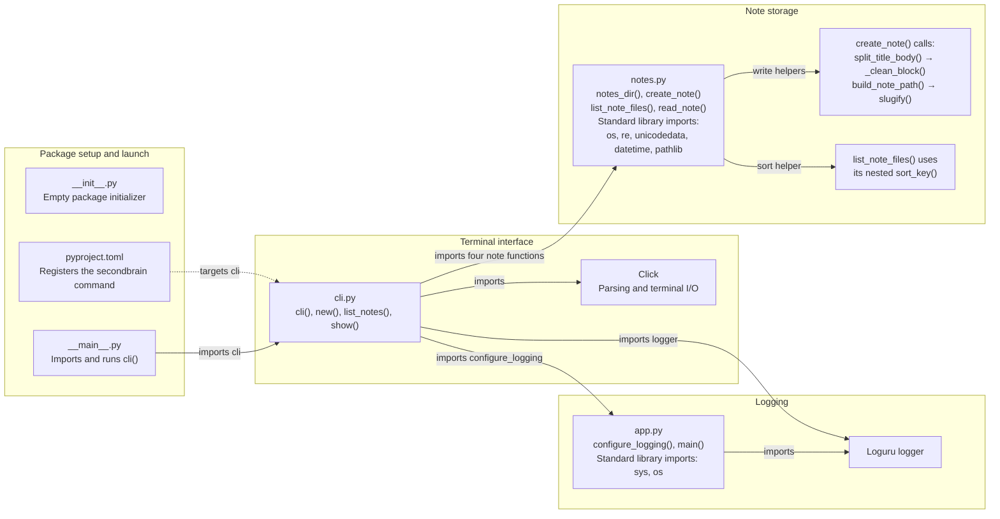
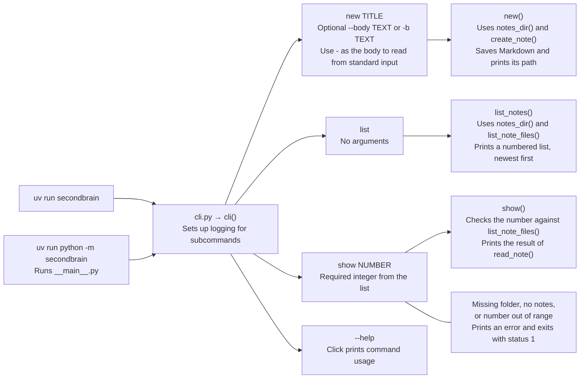
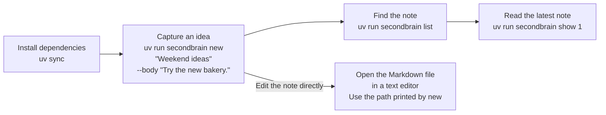

# Flowcharts

## Package files and functions

Solid arrows show imports or calls as labeled. The dashed arrow shows which
function the installed command points to.

Both `cli.py` and `notes.py` also enable postponed annotations with
`from __future__ import annotations`. Within `app.py`, `main()` calls
`configure_logging()` and logs a greeting.

## Entry points and arguments

Both terminal entry points use the same commands. `--help` works on its own or
after a subcommand. `SECONDBRAIN_DIR` selects the notes folder and defaults to
`~/secondbrain/`. `LOG_LEVEL` and `LOG_FILE` configure logging.

## Example user flow

Run these commands from the project folder. Use the number from the latest
listing when opening a note.

